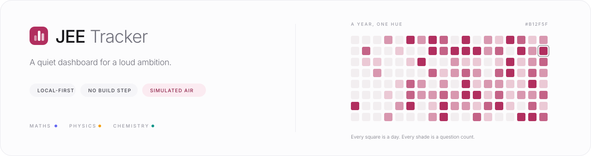
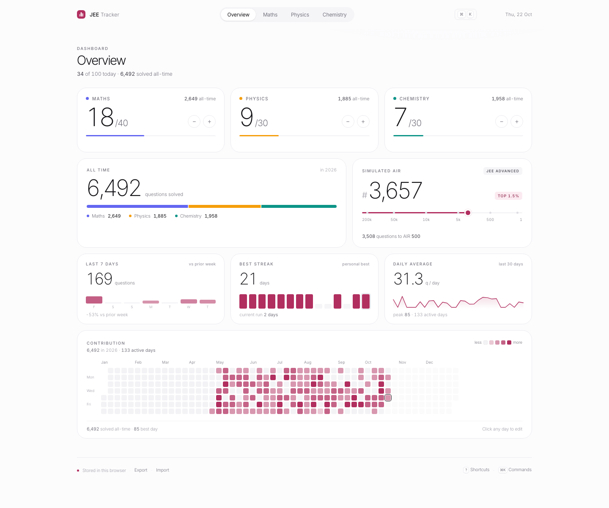
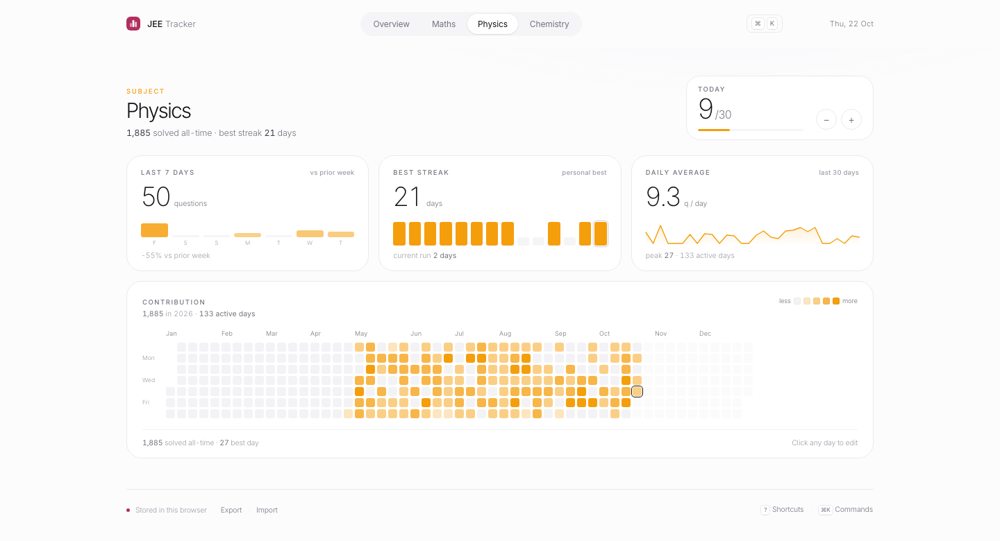
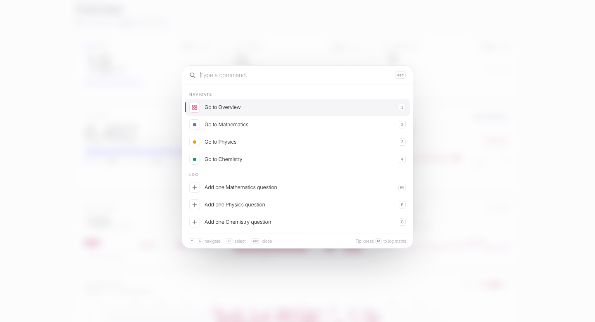
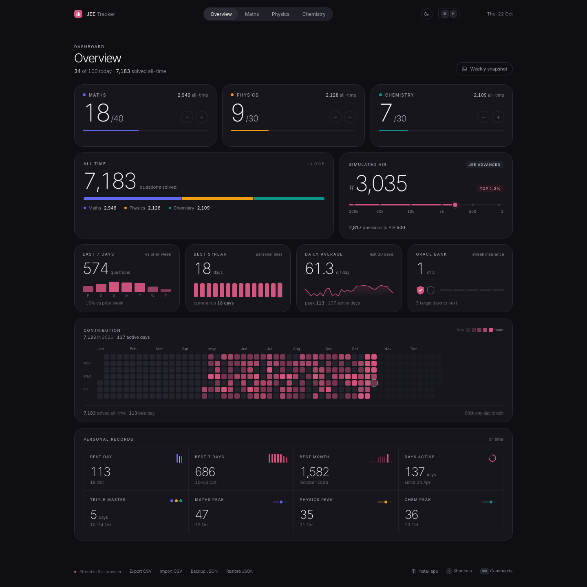
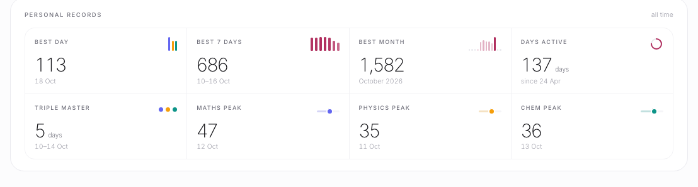
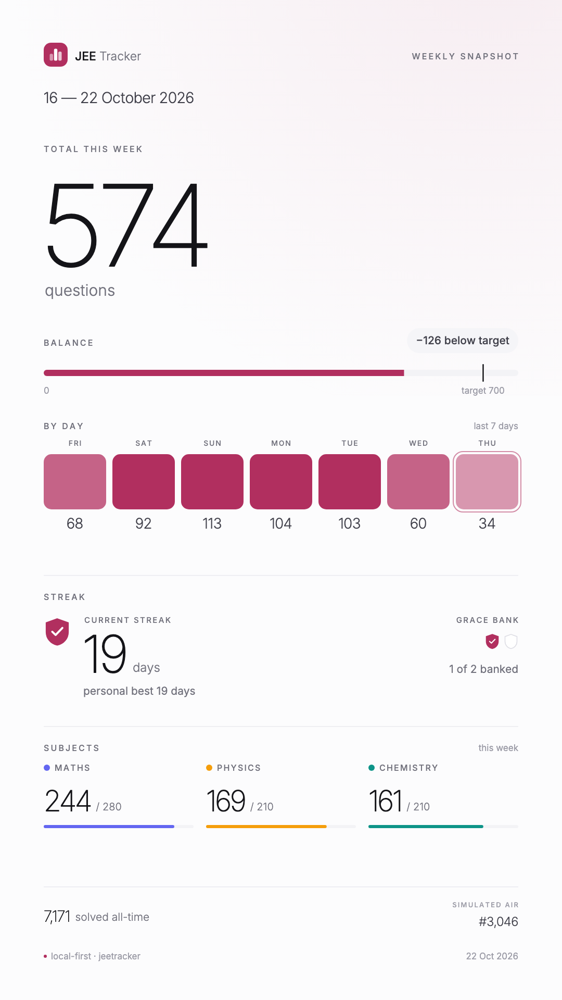
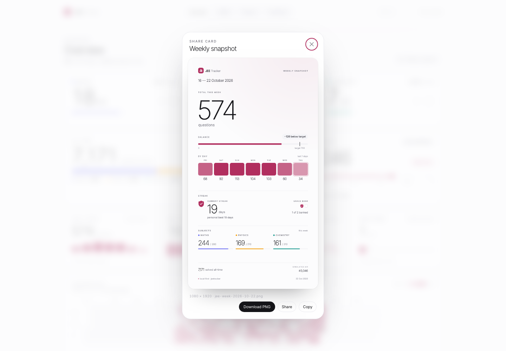
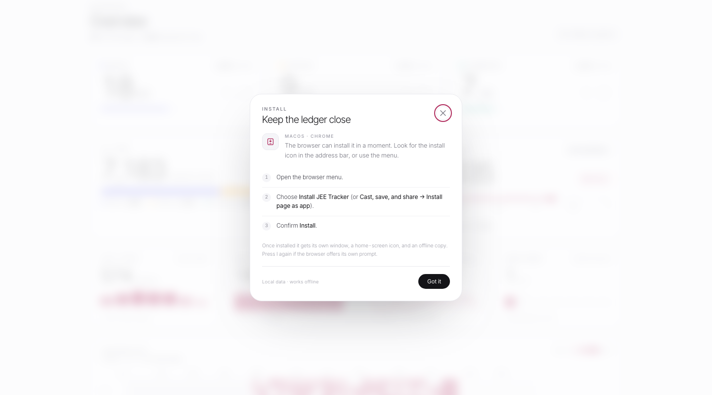

<div align="center">
  <a href="https://abhinav-prabhakar.github.io/JEETracker/">
    
  </a>
</div>

<h1 align="center">JEE Tracker</h1>

<p align="center">
  <em>A quiet ledger of showing up.</em><br>
  <sub>One hue. Three subjects. A year of small squares.</sub>
</p>

<p align="center">
  <a href="https://abhinav-prabhakar.github.io/JEETracker/">
    
  </a>
  <a href="https://github.com/Abhinav-Prabhakar/JEETracker">
    
  </a>
</p>

<p align="center">
  
  
  
  
  
  
  
  
  
</p>

<p align="center">
  <a href="#why-i-built-jee-tracker">Why</a> ·
  <a href="#the-quiet-loop">Philosophy</a> ·
  <a href="#the-dashboard">Dashboard</a> ·
  <a href="#streak-insurance">Grace</a> ·
  <a href="#personal-records">Records</a> ·
  <a href="#weekly-snapshot">Snapshot</a> ·
  <a href="#simulated-air">AIR</a> ·
  <a href="#dark-mode">Dark</a> ·
  <a href="#install-it">Install</a> ·
  <a href="#keyboard">Keys</a> ·
  <a href="#data--persistence">Data</a> ·
  <a href="#csv--spreadsheets">CSV</a>
</p>

---

## Why I built JEE Tracker
_(and why it matters, even if nothing else does)_

When I failed JEE for the last time, I didn't just lose a test. I lost the version of myself I thought the result would confirm.

In the quiet after it, motivation stopped meaning anything. What remained was smaller and more stubborn: **ritual**. Open the book. Solve one question. Close it. Come back tomorrow.

**JEE Tracker is not a productivity app. It is a ledger for that ritual.** It runs in a single HTML file. It doesn't sync to a server. It doesn't send notifications or pretend to be your friend. It keeps one hue for the year, three for the subjects, and a small bank of grace days for the weeks when showing up is the whole victory.

It just counts—**one question, one square at a time**.

There are no hacks, no gamification. Just the quiet arithmetic of effort and rest.

Because when everything else falls apart, the only question worth answering is: _can I still show up?_

And JEE Tracker answers, without fanfare: **yes. once more.**

<p align="center">
  <sub><em>If <a href="https://github.com/Abhinav-Prabhakar/GrainCLI">grain</a> counts the hours, this counts the questions. Same ritual, different unit.</em></sub>
</p>

---

<div align="center">
  <h2><em>“The rank is simulated. The showing up is not.”</em></h2>
  <sub>The only line that matters.</sub>
</div>

---

## The quiet loop

JEE Tracker isn't built for optimization. It's built for continuation. The loop is deliberately small:

| <h3>01</h3><sub>LOG</sub> | <h3>02</h3><sub>READ</sub> | <h3>03</h3><sub>REFLECT</sub> |
| :--: | :--: | :--: |
| **One question at a time.**<br><br>Use the steppers, press `M` `P` `C`, or click any day in the year to open the editor. Targets sit on the same baseline as the count. | **See the shape of the year.**<br><br>One raspberry hue for the contribution year. Three subject hues. A simulated AIR that moves only when the work does. | **Keep the week.**<br><br>Download a 9:16 share card with the last seven days: total, balance, streak, subject split, and the squares that made it. |

No sync. No noise. Just your effort, your data, and a clean place to put it.

---

## The dashboard

<p align="center">
  
</p>

<p align="center">
  <sub>Demo history, first launch. The overview carries today, all-time, simulated AIR, the grace bank, the one-hue year, and the records board.</sub>
</p>

| <h3>1</h3><sub>HTML file</sub> | <h3>0</h3><sub>dependencies</sub> | <h3>2</h3><sub>grace tokens</sub> | <h3>7</h3><sub>days per snapshot</sub> |
| :--: | :--: | :--: | :--: |

> **First run seeds a demo history** so the year, streaks, records, and AIR have something to show. Clear it in one step with <kbd>⌘K</kbd> → **Clear all data** (undoable), then log your own questions.


### A closer look

| Physics, in amber | The command palette |
| :--: | :--: |
|  |  |

### Details that wait for you

- **Week comparison.** Hover the **Last 7 days** number to read this week's daily average against last week's, in one sentence: *“You’re averaging 2 questions more than last week.”*
- **Grace history.** Hover the **Grace bank** card for tokens earned, tokens used, and the recent days the streak was protected.
- **Day breakdown.** Hover any square in the year for the date, total, and the Maths / Physics / Chemistry split.
- **Milestones.** Hover a stop on the AIR rail to see the exact question threshold behind the rank.
- **Records.** Hover a tile in the records board for the range, the definition, or how long the run lasted.

---

## Dark mode

<p align="center">
  
</p>

The same ledger, after dark. Graphite surfaces, hairline borders, and the same
raspberry year — not an inversion. The sun/moon button in the top bar switches
themes; <kbd>D</kbd> does it from anywhere, including inside a modal. Your
toggle is remembered; first visits follow the system preference. A quick QA
override is available at `?theme=dark` or `?theme=light`.

The overview tracker stays one hue, the subject pages keep indigo / amber /
teal, and the weekly share card is drawn in the dark palette when the app is
dark.

---

## Streak insurance

> A streak that punishes rest is a streak that teaches you to lie.

Consistency should survive one bad day. The tracker banks a small amount of grace:

| Rule | Detail |
| :-- | :-- |
| **Earn** | `1` token for every **5 consecutive days** at or above the overall goal of **100 questions**. |
| **Bank** | Maximum `2`. At the cap the five-day cycle closes without earning another token. |
| **Spend** | A fully missed day (`0` questions) spends one token automatically — but only while a question streak is alive. |
| **Protected** | A covered day counts toward current and best streaks (overall and per subject), keeps a soft raspberry dot in the overview year, and never counts as a target day. |
| **Today** | Can earn a token immediately. It never spends one and never resets carried progress — the day is still in progress. |

A below-target day with any questions keeps the question streak alive, resets the five-day earning progress, and spends nothing. The whole model — bank, progress, earned, used, and covered days — is replayed from history on every render. It survives reload, undo, import, export, and cross-tab sync without touching the saved schema.

Click the **Grace bank** card (or focus it) for the receipts.

---

## Personal records

<p align="center">
  
</p>

No badges. No confetti. Just the number and the day it happened.

| Record | Defined as |
| :-- | :-- |
| **Best single day** | Highest total questions in one calendar day. |
| **Best 7 days** | Highest sum across any seven consecutive calendar days. |
| **Triple Master** | Longest run of consecutive days with Maths ≥ 34, Physics ≥ 33, and Chemistry ≥ 33. |
| **Maths peak** | Highest Maths count in a day. |
| **Physics peak** | Highest Physics count in a day. |
| **Chemistry peak** | Highest Chemistry count in a day. |
| **Best month** | Highest total in a calendar month. |
| **Days active** | Days with at least one question, all time. |

The board is derived from the entire store on every render. Edit a day and the plaque rewrites itself.

---

## Weekly snapshot

| The card | The moment |
| :--: | :--: |
| <a href="assets/week-card.png"></a> |  |

A 1080 × 1920 story card with:

- the **total** for the last seven days
- a **mini heatmap row** in the same raspberry ramp as the year
- the **balance** against the weekly target of `700` — *“+34 above target”* or *“−126 below target”*
- the **current streak**, personal best, and grace bank
- the subject split, all-time total, and simulated AIR

Open it with the **Weekly snapshot** button, the command palette, or press <kbd>W</kbd>. Then download the PNG, share it through the Web Share API, or copy it to the clipboard. Nothing is uploaded; the image is drawn in your browser and handed straight back to you.

---

## Simulated AIR

The rank is a **motivational estimate**, not a prediction. It is a continuous piecewise-linear function of all-time questions solved, `Q`, with a plateau and a hard cap.

| Questions solved | Simulated AIR | Shape of the curve |
| ---: | ---: | :-- |
| 0 | **200,000** | the starting line |
| 500 | **50,000** | the plateau begins |
| 1,000 | **50,000** | plateau ends |
| 2,000 | **23,333** | ≈ 26.7 ranks/Q on this leg |
| 2,500 | **10,000** | 2 ranks/Q after this point |
| 5,000 | **5,000** | ≈ 0.9 ranks/Q after this point |
| 10,000 | **500** | ≈ 0.1 ranks/Q after this point |
| 15,000+ | **1** | hard cap |

The rail uses six anchors — `200k · 50k · 10k · 5k · 500 · 1` — and interpolates the pin inside each segment. The percentage chip assumes a candidate pool of **250,000**, purely for flavour. The curve lives in `calcAIR()`.

<details>
<summary><b>The exact curve</b></summary>

```text
AIR(Q) =
  200000                                            if Q <= 0
  round(200000 - (Q / 500) * 150000)                if 0 < Q < 500
  50000                                             if 500 <= Q < 1000        (plateau)
  round(50000 - ((Q - 1000) / 1500) * 40000)        if 1000 <= Q < 2500
  round(10000 - ((Q - 2500) / 2500) * 5000)         if 2500 <= Q < 5000
  round(5000 - ((Q - 5000) / 5000) * 4500)          if 5000 <= Q < 10000
  round(500 - ((Q - 10000) / 5000) * 499)           if 10000 <= Q < 15000
  1                                                 if Q >= 15000             (hard cap)
```

</details>

It is a toy with a hard cap. It is not a forecast, a guarantee, or a replacement for a mock test.

---

## Keyboard

Press <kbd>?</kbd> in the app for the same map.

| Keys | Action |
| :-- | :-- |
| <kbd>1</kbd> <kbd>2</kbd> <kbd>3</kbd> <kbd>4</kbd> | Overview · Maths · Physics · Chemistry |
| <kbd>M</kbd> <kbd>P</kbd> <kbd>C</kbd> | Add one question to that subject (today) |
| <kbd>⇧</kbd> + <kbd>M</kbd> / <kbd>P</kbd> / <kbd>C</kbd> | Remove one question |
| <kbd>T</kbd> | Open today's day editor |
| <kbd>W</kbd> | Open the weekly snapshot |
| <kbd>E</kbd> | Export all days as CSV |
| <kbd>⇧</kbd> + <kbd>E</kbd> | Import a CSV file |
| <kbd>D</kbd> | Toggle light / dark theme |
| <kbd>I</kbd> | Install the app |
| <kbd>⌘K</kbd> / <kbd>Ctrl K</kbd> | Command palette |
| <kbd>⌘Z</kbd> / <kbd>Ctrl Z</kbd> | Undo the last change |
| <kbd>?</kbd> | Shortcut sheet |
| <kbd>Esc</kbd> | Close the snapshot, palette, sheet, or editor |

Shortcuts pause automatically while you are typing.

---

## Run it

**Live:** [abhinav-prabhakar.github.io/JEETracker](https://abhinav-prabhakar.github.io/JEETracker/)

Locally, there is nothing to install:

```bash
git clone https://github.com/Abhinav-Prabhakar/JEETracker.git
cd JEETracker
open index.html
```

For the installable and offline path, serve it from localhost (a secure context, so the service worker can register):

```bash
python3 -m http.server 8080
# http://localhost:8080
```

The CSV parser and its round-trip rules have a dependency-free Node suite:

```bash
node --test tests/csv.test.mjs
```

The repository is deployed with **GitHub Pages** from `main` / `(root)`. There is no build step, no actions pipeline, and no server.

---

## Install it

JEE Tracker is a proper installable PWA. The icon opens it without browser chrome, the manifest offers **Today's log** and **Weekly snapshot** shortcuts, and the app shell is cached for offline use. No store, no account, no separate build.

| Platform | How |
| :-- | :-- |
| **iPad / iPhone** | Open the live site in **Safari** → **Share** → **Add to Home Screen**. Safari is the browser that installs a home-screen web app on iPadOS. |
| **Windows** | In Chrome or Edge: browser menu → **Install JEE Tracker** (Edge also has **Apps → Install this site as an app**). |
| **macOS** | Safari 17+ → **File → Add to Dock**. Chrome or Edge → menu → **Install JEE Tracker**. |
| **Any browser** | Press <kbd>I</kbd> in the app, or use **Install app** in the footer / command palette. |

If the browser offers its own install prompt, <kbd>I</kbd> opens it. If it does not, the app shows the exact steps for the current platform. Installed or not, the journal lives in `localStorage`; installation only changes how the app opens.

<p align="center">
  
  <br><sub>Press <kbd>I</kbd> anywhere. The sheet adapts to iPadOS, Windows, macOS and the current browser.</sub>
</p>

**Static deployment.** `manifest.webmanifest`, `sw.js`, and `assets/icons/` sit at the repo root, and every URL in the manifest is relative. That keeps `start_url`, `scope`, and the service worker inside `/JEETracker/` on GitHub Pages. The service worker is **network-first for navigation** and stale-while-revalidate for same-origin assets, so an online reload picks up the latest HTML instead of pinning an old build. Old caches are deleted on activate. Icons and the manifest are precached; the README screenshots are not.

---

## Data & persistence

Everything lives in **two localStorage keys** on your machine. The tracker data
is one; the theme choice is the other.

| | |
| :-- | :-- |
| **Key** | `jee-tracker.v2` |
| **Writes** | Every mutation schedules a 120 ms save; the *Saved* dot confirms it. |
| **Flush** | Pending writes flush on `beforeunload`. |
| **Sync** | The `storage` event refreshes other open tabs. |
| **Undo** | The last 60 states, in memory. |
| **Migration** | The original `jee-tracker.v1` payload is imported on first run. |
| **Portability** | Export a timestamped JSON backup, restore one, or move days through a spreadsheet-friendly CSV. Imports are validated, merged, and undoable. |
| **Theme** | `jee-tracker.theme` stores `light` or `dark` after an explicit toggle. |

<details>
<summary><b>The saved shape</b></summary>

```json
{
  "version": 2,
  "data": {
    "2026-10-22": { "m": 18, "p": 9, "c": 7 }
  },
  "prefs": { "view": "overview" }
}
```

</details>

There is no server, no account, and no analytics. The only cross-origin request is for the **Inter / Inter Tight** webfonts; same-origin app files are cached by the service worker so the tracker keeps working offline. Remove the `<link>` tags in `index.html` for a fully self-contained copy.

> The data layer is the browser: a small, explicit store (`loadState` → `persist` → `render`) with a versioned schema, import/export, cross-tab sync, and undo.

---

## CSV & spreadsheets

The JSON backup is the full snapshot. CSV is the door to a spreadsheet —
export the ledger, edit it in Sheets or Excel, and bring it back.

### Export

Use **Export CSV** in the footer, **Export CSV** in the palette, or press
<kbd>E</kbd>. The file is `jee-tracker-YYYY-MM-DD.csv` (the export date),
sorted oldest first and covering every year:

```csv
date,maths,physics,chemistry,total
2024-02-29,5,6,7,18
2026-10-21,20,21,22,63
2026-10-22,30,31,32,93
```

Fields use RFC 4180 quoting, rows end in CRLF, and the file is plain UTF-8.
`total` is recomputed on export and ignored on import. Every export raises a
toast with the day count.

### Import

Use **Import CSV** in the footer, the palette, or press <kbd>⇧</kbd> +
<kbd>E</kbd>. The header is optional and case-insensitive:

| Field | Accepted names |
| :-- | :-- |
| date | `date`, `day` |
| maths | `maths`, `math`, `mathematics`, `m` |
| physics | `physics`, `phys`, `p` |
| chemistry | `chemistry`, `chem`, `c` |
| total | `total` — optional, ignored |

When the first cell is not a date header, the file is read headerless in the
canonical order `date,maths,physics,chemistry`:

```csv
2026-10-21,20,21,22
2026-10-22,30,31,32
```

The reader understands quoted fields, doubled quotes, commas inside quotes,
CRLF / LF / CR, blank lines, and an optional UTF-8 BOM.

**Validation**

- Dates must be real ISO `YYYY-MM-DD` keys, from 1900 onward, and never in the
  future. A bad or future date skips that row and counts as skipped.
- Subject values must be integers. Blank cells are `0`; negative values clamp
  to `0`; values above `9999` clamp to `9999`. A non-numeric value skips the
  row rather than silently becoming zero. A subject column that is absent
  (for example a headerless file with only `date,maths`) also reads as `0`.
- Duplicate dates are allowed; the last row wins.

**Merge**

| In the CSV | In the store |
| :-- | :-- |
| A valid date | Overwrites that day's Maths, Physics and Chemistry |
| A date with three zeros | Deletes the day |
| A date not in the file | Left exactly as it was |
| Duplicate dates | The last row wins |

The whole file is one commit: one toast (`Imported N days · M rows skipped`) with
**Undo**, one `⌘Z` / `Ctrl Z` restore, and an immediate save. Empty files, a bad
header, or a file with no valid rows raise a quiet toast and change nothing. Days
from every year are kept; nothing is scoped to the current one.

---

## Design system

The full contract lives in **[design.md](design.md)**.

| Token | Value | Role |
| :-- | :-- | :-- |
| Accent | `#B12F5F` *(rgb 177, 47, 95)* | brand, overview heatmap, focus, live markers |
| Mathematics | `#6366F1` | indigo |
| Physics | `#F59E0B` | amber |
| Chemistry | `#0D9488` | teal |
| Ink | `#141418` | type, primary buttons |
| Canvas | `#FCFCFD` | page |
| Line | `#EAEAEF` | 1 px borders |

**Physics and Chemistry are deliberately swapped** from the first iteration: amber is Physics, teal is Chemistry. The overview contribution tracker is strictly monochrome — one raspberry hue, four densities — while subject heatmaps inherit their subject's hue.

| Principle | In practice |
| :-- | :-- |
| **One accent** | The brand owns raspberry; subject data owns subject hues. The product never uses both at once in the same encoding. |
| **Quiet surfaces** | Hairline borders, no shadows at rest. Elevation appears only on hover. |
| **Hover is a second layer** | Percentages, best days, grace receipts, and milestone maths wait until asked. |
| **Numbers are typography** | Light display numerals, tabular figures, targets on the same baseline. |
| **Motion confirms** | 180–600 ms, one easing family, no autoplay. Everything stops under `prefers-reduced-motion`. |

Display numerals use **Inter Tight 200**, UI text uses **Inter 300–500**, and cards are 22 px radius.

---

## Under the hood

<details>
<summary><b>Project structure and code map</b></summary>

```text
JEETracker/
├── index.html            # the entire app: tokens, markup, store, AIR, views, snapshot
├── manifest.webmanifest  # installable PWA metadata
├── sw.js                 # app-shell cache, network-first navigation
├── design.md             # design system + component contracts
├── README.md
├── tests/
│   └── csv.test.mjs      # CSV parser, validation and round-trip suite
├── .nojekyll             # GitHub Pages
└── assets/
    ├── icons/            # 192 / 512 / maskable / Apple touch / favicon PNGs
    ├── banner.svg
    ├── preview.png
    ├── preview-dark.png
    ├── subject.png
    ├── subject-dark.png
    ├── palette.png
    ├── records.png
    ├── install.png
    ├── snapshot.png
    └── week-card.png
```

Inside `index.html`:

| Block | Responsibility |
| :-- | :-- |
| `:root` | Design tokens (colour, radius, easing) |
| `loadState` / `persist` | Versioned localStorage store, migration, cross-tab sync |
| `summarize` | Derived metrics (today, all-time, 7-day, streaks, average) |
| `computeInsurance` | Deterministic grace-bank replay |
| `computeRecords` | All-time records model |
| `calcAIR` | Piecewise rank curve and rail position |
| `buildOverview` / `buildSubjectView` | Static skeletons, built once |
| `render*` | Targeted updates — numbers, rails, bars, graph cells |
| `buildGraph` | The 53 × 7 year grid, tooltips, day editor hook |
| `renderSnapshot` | Canvas 2D 1080 × 1920 share card |
| `COMMANDS` | Palette actions, grouped and searchable |
| `csvParse` / `csvSerialize` / `csvMerge` | RFC 4180 reader, writer, validation and merge rules |
| `initPWA` / `openInstall` | Install prompt, platform sheet, service-worker registration |
| `handleLaunchAction` | Opens `?action=today` / `?action=snapshot`, then cleans the URL |
| `bindEvents` / `init` | Keyboard map, midnight rollover, boot |

No frameworks, no build step, no dependencies.

</details>

---

## What it isn't

- Not a syllabus tracker. It counts questions, not chapters.
- Not a social feed. There is nothing to post, compare, or perform.
- Not a real rank predictor. The AIR is a toy with a hard cap.
- Not a reason to skip rest. The grace days exist precisely because rest is part of the work.
- Not our data. It stays in your browser; export it if it matters.

---

## Roadmap

- [x] CSV / spreadsheet export and import
- [ ] Chapter-level tags and weak-topic analysis
- [ ] Mock-test log with score → rank overlay
- [x] Installable PWA with offline caching

---

<p align="center">
  <sub><em>Built for the days when motivation is gone and the only thing left is the next question.</em></sub><br><br>
  <sub>Vanilla HTML, CSS and JavaScript · Inter &amp; Inter Tight · no build, no backend, no noise.</sub><br><br>
  <sub>Built by <a href="https://github.com/Abhinav-Prabhakar">Abhinav</a> · <a href="https://github.com/Abhinav-Prabhakar/GrainCLI">grain</a> for the hours, JEE Tracker for the questions.</sub>
</p>
